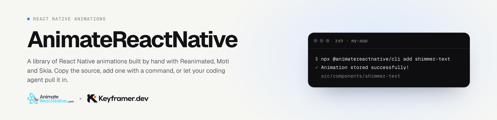

<a href="https://www.animatereactnative.com">
  <picture>
    <source media="(prefers-color-scheme: dark)" srcset="https://raw.githubusercontent.com/animate-react-native/.github/main/profile/banner-dark.png">
    
  </picture>
</a>

**[AnimateReactNative.com](https://www.animatereactnative.com)** is a library of React Native animations built by hand with Reanimated, Gesture Handler, Moti and Skia, each one recorded on a real device. You get the real source: copy it from the page, add it with one command, or let your coding agent pull it in and fit it to your app.

[Browse the animations](https://www.animatereactnative.com/animations) · [Free ones](https://www.animatereactnative.com/free-react-native-animations) · [Pricing](https://www.animatereactnative.com/pricing)

## Open source

Small libraries that came out of building the animations. Free on npm.

| Package | What it is | Install |
| --- | --- | --- |
| [marquee](https://github.com/animate-react-native/marquee) | An infinite scrolling marquee, powered by Reanimated. Wraps any component, on iOS, Android and Web. | `npm install @animatereactnative/marquee` |
| [stagger](https://github.com/animate-react-native/stagger) | Cascades any group of children in and out, with Reanimated layout animations. | `npm install @animatereactnative/stagger` |
| [accordion](https://github.com/animate-react-native/accordion) | An accordion for content with a dynamic height, without layout shifts for its siblings. | `npm install @animatereactnative/accordion` |
| [ggwave](https://github.com/animate-react-native/ggwave) | Data over sound. Two phones pass bytes through the air with no network, no pairing and no account. | `npm install @animatereactnative/ggwave` |
| [skia-loaders](https://github.com/animate-react-native/skia-loaders) | 20 particle-trail loaders drawn with Skia and driven entirely on the UI thread. | `npm install @animatereactnative/skia-loaders` |

## For your coding agent

| | What it does | Set it up |
| --- | --- | --- |
| [Skill](https://github.com/animate-react-native/skill) | Free. Teaches your agent how React Native animations are built: one driver, springs, gestures, lists. | `npx skills add animate-react-native/skill` |
| MCP server | Your agent searches the library and reads an animation's real source. | `claude mcp add --transport http animatereactnative https://www.animatereactnative.com/mcp` |
| [CLI](https://github.com/animate-react-native/cli) | Adds one animation to your project, or syncs the whole library to your machine. | `npx @animatereactnative/cli add <slug>` |

## Try them on your phone

The free preview app runs the whole library on a real device: [App Store](https://apps.apple.com/app/animatereactnative/id6738016513) · [Google Play](https://play.google.com/store/apps/details?id=com.animatereactnative.preview)

https://github.com/animate-react-native/.github/assets/2805320/b47be441-f7fa-4552-a68b-4b76002b20fb
